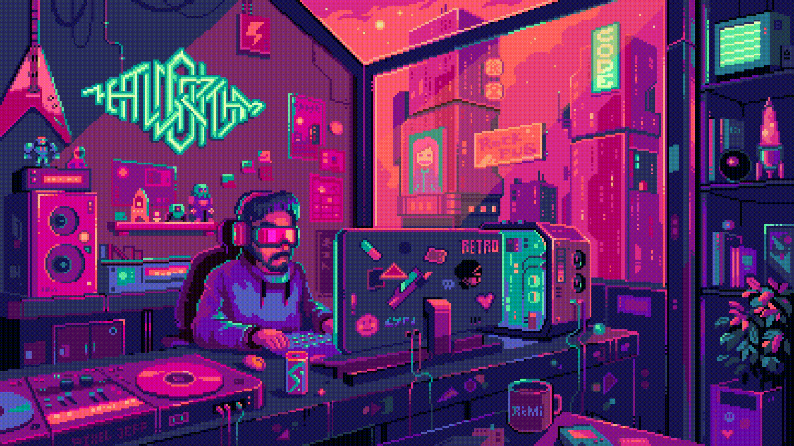

  
  

---

###  &nbsp;About Me

- 🔭 &nbsp;**Senior Engineer @ IBM India Systems Development Lab** *(Bengaluru)*
- 🛡️ &nbsp;Building **OS & open-source tooling for IBM Confidential Computing on LinuxONE**
- 🚀 &nbsp;**10+ years** shipping end-to-end products • **5+ years** in enterprise engineering
- 🌱 &nbsp;Daily driver: **Go, Python, Docker, Kubernetes, Terraform, Ansible**
- 💬 &nbsp;Ask me about **Linux Kernel, Backend Systems, DevOps, Arduino, Raspberry Pi, EaglePCB**
- 📫 &nbsp;Reach me at **[hi@sashwat.in](mailto:hi@sashwat.in)**
- 👨‍💻 &nbsp;More on my **[Website](https://sashwat.in)** & **[CV](https://sashuu69.github.io/curriculum-vitae/sash-cv.pdf)**
- ⚡ &nbsp;Off-keyboard: **Motorcycle rides, cycling, swimming & ham radio**
- 🏢 &nbsp;Work account: **[Sashwat-K](https://github.com/Sashwat-K)** *(IBM)*

 

---

### 🧰 &nbsp;Tech Stack

**Languages**

**DevOps & Cloud**

**Hardware & Tools**

---

### 🚀 &nbsp;Featured Projects

<table>
  <tr>
    <td width="50%" valign="top">
      <h4>🛡️ <a href="https://github.com/Sashwat-K/contract-go">contract-go</a></h4>
      
Go SDK for IBM Confidential Computing — handles workload contract signing, attestation, and encryption without manual cryptography.

      
 

    </td>
    <td width="50%" valign="top">
      <h4>⚙️ <a href="https://github.com/Sashwat-K/contract-cli">contract-cli</a></h4>
      
CLI companion to <code>contract-go</code> for generating and managing confidential workload contracts from the terminal.

      
 

    </td>
  </tr>
  <tr>
    <td width="50%" valign="top">
      <h4>🏗️ <a href="https://github.com/Sashwat-K/terraform-provider-hpcr">terraform-provider-hpcr</a></h4>
      
Terraform provider for declarative contract generation on IBM Hyper Protect Confidential Container Runtime.

      
 

    </td>
    <td width="50%" valign="top">
      <h4>💧 <a href="https://github.com/sashuu69/iot-water-level-indicator">iot-water-level-indicator</a></h4>
      
End-to-end IoT system using Raspberry Pi, Arduino, Firebase, and a companion Android app.

      
  

    </td>
  </tr>
  <tr>
    <td colspan="2" valign="top">
      <h4>🌐 <a href="https://github.com/sashuu69/portfolio-website-infrastructure">portfolio-website-infrastructure</a></h4>
      
Self-hosted infrastructure powering <a href="https://sashwat.in">sashwat.in</a> — provisioned with Terraform, configured with Ansible, deployed via Docker Compose.

      
   

    </td>
  </tr>
</table>

---

### 📊 &nbsp;GitHub Stats

---

### ✍️ &nbsp;Latest Writing

- 📝 &nbsp;**[Automating IBM Confidential Computing Contracts](https://sashwat.in)** — How `contract-go`, `contract-cli` and the Terraform provider eliminate manual cryptography for confidential workloads on IBM Z. *(Apr 2026)*
- 📚 &nbsp;More posts on **[sashwat.in](https://sashwat.in)**

---

### 🌐 &nbsp;Connect With Me

---

### ☕ &nbsp;Support My Work

 

  <i>⭐ From <a href="https://github.com/sashuu69">sashuu69</a> — Thanks for stopping by!</i>

